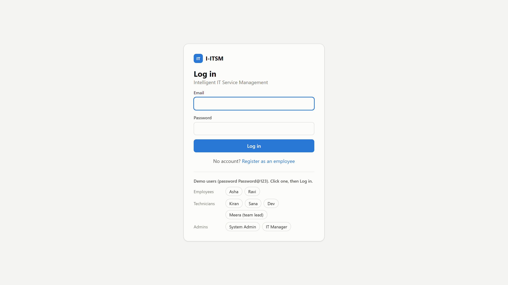
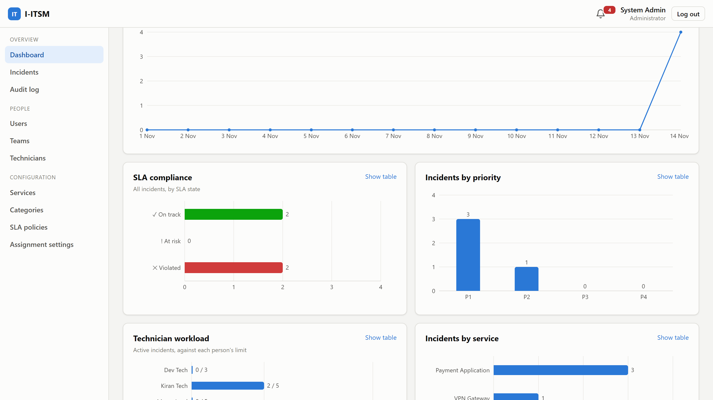
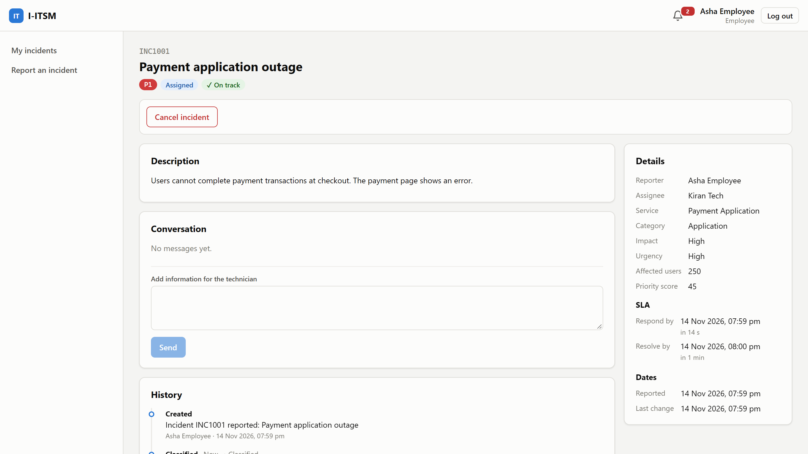
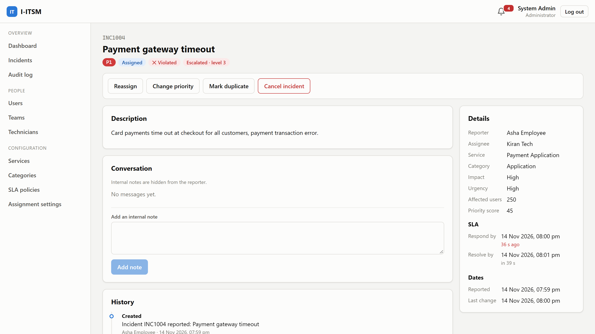

# I-ITSM: Intelligent IT Service Management & Incident Resolution System

CS F213 OOP course project (due 22 Nov 2026). Employees report IT incidents; the system prioritises them, assigns a technician, tracks SLA deadlines, escalates what nobody picks up, sends notifications and keeps an audit trail.

| | |
|---|---|
|  |  |
|  |  |

## Features

- **Report an incident** with a suggested category and a warning about possible duplicates.
- **Automatic priority and assignment:** a score from impact, urgency and service criticality gives P1 to P4, and a technician is chosen by skill, load or round-robin (an admin can switch the strategy).
- **A complete lifecycle:** acknowledge, work, ask the reporter for information, resolve, verify, rate and close. The allowed status changes are enforced, so an incident cannot jump from NEW to CLOSED.
- **SLA tracking** with response and resolution deadlines, an "at risk" warning, violation detection, and a clock that pauses while waiting for the reporter.
- **Automatic escalation** of unanswered incidents to the team lead, then the administrators, then the IT managers.
- **Notifications** in the app (bell with unread count) and by email, plus an **audit trail** of everything that happens to an incident.
- **Screens for every role:** employees, technicians and team leads, administrators and IT managers.
- **Admin tools:** dashboard with charts, search and filters, audit log, and management of users, teams, technicians and skills, services, categories, SLA policies and assignment settings.
- **AI guide (optional):** a side panel that explains the app and the incident on screen.
- **Quality:** a REST API with Swagger, JWT security, more than 650 automated tests and a one-click demo mode.

**Stack:** Java 21 · Spring Boot 3.3 (layered monolith) · PostgreSQL 16 · Flyway · Spring Data JPA · Spring Security + JWT · React 18 + Vite (JavaScript)

**Contents:** [1. How to run everything](#1-how-to-run-everything) · [2. Development checklist](#2-development-checklist) · [3. Code guide](#3-code-guide-how-the-project-is-built) · [4. Documents and diagrams](#4-documents-and-diagrams)

---

# 1. How to run everything

**Needs:** Java 21 or newer, Maven, Node.js 18 or newer, Docker Desktop (running), Git.

**One click (Windows):** double-click `start-iitsm.bat` in the repo root. It starts Docker (Postgres and Mailpit), the backend and the frontend, waits until they answer and opens the app. `start-iitsm-demo.bat` does the same in demo mode (see below), and `stop-iitsm.bat` stops everything. The first start is slow (Maven and npm download packages). If something else already uses port 8080 or 5173, stop it first. **Known quirk:** the frontend window sometimes opens but does not start the app by itself. If the browser cannot open http://localhost:5173, click into the "I-ITSM frontend" window and type `npm run dev`.

**By hand** (three steps):

```bash
git clone https://github.com/aditya7245/IITSM.git
cd IITSM
docker compose up -d --wait          # Postgres + Mailpit, waits until the database is ready

cd backend
mvn spring-boot:run                  # API on http://localhost:8080

# in a second terminal, from the repo root
cd frontend
npm install                          # first time only
npm run dev                          # app on http://localhost:5173
```

| What | URL |
|---|---|
| The app (log in here) | http://localhost:5173 |
| Swagger UI (try the API) | http://localhost:8080/swagger-ui.html |
| Health | http://localhost:8080/actuator/health |
| Mailpit (caught emails) | http://localhost:8025 |

**Demo users** (dev profile, password `Password@123`, all `@iitsm.local`):

| Email | Who | Role |
|---|---|---|
| `emp1@`, `emp2@` | Asha, Ravi | employee |
| `tech1@`, `tech2@`, `tech3@` | Kiran, Sana, Dev | technician |
| `lead.app@` | Meera | team lead (Application Support) |
| `admin@` | System Admin | administrator |
| `manager@` | IT Manager | IT manager |

**Check the API works** (PowerShell):

```powershell
Invoke-RestMethod -Method Post -Uri http://localhost:8080/api/auth/login -ContentType "application/json" -Body '{"email":"admin@iitsm.local","password":"Password@123"}'
```

You should get a `token` back. In Swagger UI, click **Authorize**, paste the token (without the word Bearer) and every request sends it.

**Demo mode** makes SLA deadlines and escalations happen in seconds (time scale 20, checks every 5 seconds). Start the backend with the profiles `dev,demo`:

```powershell
cd backend
$env:SPRING_PROFILES_ACTIVE = "dev,demo"
mvn spring-boot:run
```

The three demo workflows to follow are in [`docs/demo-script.md`](docs/demo-script.md). The test cases are catalogued in [`docs/TEST_CASES.md`](docs/TEST_CASES.md).

**AI guide (optional).** The chat button in the top bar opens the I-ITSM Guide, an AI assistant that explains the app and the incident on screen. It works with any provider that offers the OpenAI-style chat-completions API, and stays switched off (the panel says "not set up") until the backend is given a provider. Put these in a `.env` file in the project root (Git ignores it; the backend reads it at start-up, and real environment variables override it). The key stays on the server and must never go into the frontend or Git:

```properties
# the provider's OpenAI-compatible address
ASSISTANT_BASE_URL=https://api.groq.com/openai/v1
# leave empty for a local Ollama
ASSISTANT_API_KEY=<your key>
# a chat model from the provider's model list (keep comments on their own lines)
ASSISTANT_MODEL=openai/gpt-oss-120b
```

Restart the backend after changing it. The tests ignore these settings, so they never call a real provider.

| Provider | `ASSISTANT_BASE_URL` |
|---|---|
| Groq (free tier) | `https://api.groq.com/openai/v1` |
| Google Gemini (free tier) | `https://generativelanguage.googleapis.com/v1beta/openai` |
| OpenRouter (free `:free` models) | `https://openrouter.ai/api/v1` |
| Ollama on this PC (free, no key) | `http://localhost:11434/v1` |

**Run tests** (Docker must be running): `cd backend && mvn clean verify`. To check that the frontend compiles: `cd frontend && npm run build`.

**Stop / reset:** `docker compose down` (keep data) · `docker compose down -v` (wipe the database, so the next start has fresh demo data and incident numbers start again at INC1001).

**If something breaks**

| Problem | Fix |
|---|---|
| Test error "Could not find a valid Docker environment" | Start Docker Desktop. If it still fails, run once: `"api.version=1.44" \| Out-File -Encoding ascii "$HOME\.docker-java.properties"` |
| "Connection refused" to the database | Run `docker compose up -d --wait` and wait a few seconds |
| Flyway "checksum mismatch" | A migration was edited. Never edit an applied migration (V1 to V5); add a new `V<n>` file. Locally: `docker compose down -v` and restart |
| The backend, the health check or the email tests are very slow | A VPN or DNS tool (for example Cloudflare WARP) can slow down connections to Mailpit. Turn it off while running the demo or the tests |
| The app says "Cannot reach the server" | The backend is not running, or `VITE_API_URL` points to the wrong address (default `http://localhost:8080`; copy `frontend/.env.example` to `frontend/.env` to change it) |
| Swagger answers 401 | Log in through `POST /api/auth/login`, then use **Authorize** and paste the token |
| Port 8080 or 5173 already in use | Run `stop-iitsm.bat`, or stop the other program using the port |

---

# 2. Development checklist

How the project was built, item by item, in dependency order: every item only depends on items above it. Each item says in plain words what it does and why. Ticked items (`[x]`) are finished.

### Progress

**Checklist items done:** 52 of 54 (all of Phases 1 to 7, plus 8.2, 8.3 and 8.5).

| Phase | Items | Done |
|---|---|---|
| 1 Foundations | 1.1 to 1.10 | all |
| 2 Pure business rules | 2.1 to 2.8 | all |
| 3 Events, audit, notifications | 3.1 to 3.4 | all |
| 4 Services | 4.1 to 4.10 | all |
| 5 REST API | 5.1 to 5.7 | all |
| 6 Demo and tests | 6.1 to 6.3 | all |
| 7 Frontend | 7.1 to 7.7 | all |
| 8 Innovation and documents | 8.1 to 8.5 | 8.2, 8.3, 8.5 (8.1 optional and not built; 8.4 is the demo video) |

### Phase 1: Foundations (types, config, entities, repositories)

- [x] **1.1 Base entity classes.** Some database tables record only when a row was created, others also when it was last changed. We need two small parent classes so each table's Java class matches its table exactly. We also let an incident's creation time be set by us, because the SLA timer starts from it.

- [x] **1.2 Enums.** Fixed lists of values the whole app uses (incident statuses, priorities, SLA states, comment types), with small helper methods such as "is this incident still open?".

- [x] **1.3 Time and test infrastructure.** Tests need to control the clock (to check SLA deadlines without waiting) and share one database setup. This item builds both, plus a few error types and settings classes later items need.

- [x] **1.4 Migration V4.** Incidents need readable numbers like INC1001, generated safely by the database. We also loosen the duplicate-detection setting so it actually catches similar short titles.

- [x] **1.5 Reference entities and repositories.** Java classes for the lookup data: skills, which technician has which skill, incident categories and the IT services that can break.

- [x] **1.6 System configuration.** A small settings table the admin can change at runtime (for example which assignment strategy is active), and a helper to read it.

- [x] **1.7 SLA policy lookup.** Given a priority and a service, find out how many minutes the team has to respond and resolve. A service can override the default times.

- [x] **1.8 Incident entity and repository.** The central object of the whole system: one reported problem, with everything we track about it. This item only stores the data; behaviour comes later.

- [x] **1.9 Supporting entities.** Classes for comments, feedback, the audit history and notifications.

- [x] **1.10 Repository queries needed later.** A few database questions later features will ask: who are exactly the administrators, which technicians are free, how many active incidents does a technician have.

### Phase 2: Pure business rules (plain JUnit, no database)

- [x] **2.1 Priority calculator (Strategy).** The rule that turns "how bad, how urgent, how important is the service" into P1 to P4, automatically.

- [x] **2.2 Incident state machine (State pattern).** The rulebook for an incident's life: which status it may move to next. It stops nonsense like jumping from NEW straight to CLOSED.

- [x] **2.3 SLA evaluator.** The stopwatch logic. It works out the response and resolution deadlines, and says whether an incident is on track, close to its deadline (80%), or late. Time spent waiting for the user does not count.

- [x] **2.4 Incident behaviour methods.** Teach the Incident object to do things itself (acknowledge, resolve, pause the SLA clock, and so on), always checking the rulebook from 2.2 first.

- [x] **2.5 Text tokenizer.** Breaks a sentence into clean lowercase keywords, ignoring filler words like "the" and "is". The smart features that compare text all rely on it.

- [x] **2.6 Category suggester (intelligent feature 1).** Reads the problem description and suggests the most likely category (for example, "payment" points to Application). Smart feature number one.

- [x] **2.7 Similarity strategy.** A score from 0 to 1 for how alike two texts are. Used to spot duplicate reports.

- [x] **2.8 Assignment strategies (Strategy pattern, intelligent feature 2).** Three interchangeable ways to pick a technician: best skill match, least busy, or take turns. The admin can switch between them without changing code.

### Phase 3: Events, audit and notifications

- [x] **3.1 Event model and observer plumbing (Observer pattern).** Whenever something happens to an incident, the system announces it, and independent listeners (audit log, notifications) react. This builds the announcement and the listener mechanism.

- [x] **3.2 Audit observer and history.** Every event is written to a permanent history log, so we can always see who did what and when. It cannot be edited afterwards.

- [x] **3.3 Notification channels (Factory pattern).** The ways we can notify someone: a message inside the app and an email. A small factory hands out the right one, so a new channel (like SMS) can be added later.

- [x] **3.4 Notification rules and observer.** Decides who gets told about which event, and sends it in the background after the change is safely saved, so a mail problem can never break an incident update.

### Phase 4: Services (putting the pieces together)

- [x] **4.1 Current user and access policy.** Who is allowed to do what. An employee sees only their own incidents, a technician only theirs, admins everything.

- [x] **4.2 Incident factory (Factory pattern).** One place that turns a submitted report form into a valid new incident, rejecting bad input.

- [x] **4.3 Assignment service.** Finds the right technician using whichever strategy the admin selected, skipping people who are unavailable or already full.

- [x] **4.4 Duplicate detection service (intelligent feature 3).** When someone reports a problem, check whether very similar open reports already exist for the same service and warn about them. Smart feature number three.

- [x] **4.5 Create incident flow.** The big one: reporting a problem triggers the whole chain (create, prioritize, set SLA deadlines, check duplicates, assign a technician, notify). This is demo workflow 1.

- [x] **4.6 Lifecycle operations.** All the actions people take after creation: acknowledge, start, resolve, verify, reopen, cancel, close, mark duplicate, reassign, change priority. Each checks who is allowed, applies the change and announces the event.

- [x] **4.7 Comments and information requests.** Notes, and the back-and-forth where a technician asks the user for more information. While waiting for the user, the SLA clock pauses.

- [x] **4.8 Feedback and automatic close.** After the user confirms the fix, they rate it, and the incident closes by itself.

- [x] **4.9 SLA monitor.** A background job that keeps checking deadlines and raises a warning at 80% and a violation when the deadline passes, once each.

- [x] **4.10 Auto-escalation (intelligent feature 4).** If a critical (P1) incident is not acknowledged in time, the system alerts the next person up the chain, then the next. Smart feature number four.

### Phase 5: REST API (what the frontend will call)

- [x] **5.1 DTOs and mappers.** Clean, simple data shapes for what the API sends and receives, so internal database objects never leak out.

- [x] **5.2 Incident endpoints.** The web addresses for reporting and working on incidents.

- [x] **5.3 Search and filtering.** Finding incidents by number, status, priority, category, service, technician, SLA state or date, with pages. Each person only sees what they are allowed to.

- [x] **5.4 Notification and audit endpoints.** Let users read their own notifications, and let admins browse the audit history.

- [x] **5.5 Registration, current user and user administration.** Employees can sign up themselves; admins create and manage users, teams, technicians and their skills.

- [x] **5.6 Configuration administration.** Admin screens' backend: manage IT services, categories, SLA times and which assignment strategy is active.

- [x] **5.7 Reports (admin only).** The numbers for the dashboard: totals, who is busy, which services break most, SLA health, incidents per day.

### Phase 6: Demo and test suite

- [x] **6.1 Demo profile and script.** A speed-up setting so deadlines and escalations happen in seconds during the recorded demo, plus a written script of the three workflows to follow.

- [x] **6.2 Workflow integration tests.** Automated tests that replay the three demo workflows, moving a fake clock forward instead of waiting.

- [x] **6.3 Test case catalogue.** The written list of at least 18 test cases that the course requires, linked to the real automated tests.

### Phase 7: Frontend (React, in `frontend/`)

Technology and conventions: **Vite + React 18, JavaScript (not TypeScript)**, `react-router-dom` v6, `axios`, `recharts`, plain CSS (no UI framework). API base URL from `VITE_API_URL` (default `http://localhost:8080`). The token is stored in `localStorage` under `iitsm_token`. Role groups: employee = EMPLOYEE; technician = TECHNICIAN or TEAM_LEAD; admin = ADMINISTRATOR or IT_MANAGER. Impact and urgency selects show Low, Medium, High (sent as 1, 2, 3).

- [x] **7.1 Scaffold, API client and auth.** Create the React app, and make login, registration and role-based redirects work.

- [x] **7.2 App shell and notifications.** The page frame with a menu per role and a notification bell.

- [x] **7.3 Employee pages.** Everything an employee does: report a problem, see their incidents, answer questions, confirm the fix, rate it.

- [x] **7.4 Technician pages.** Everything a technician does: see assigned incidents and workload, investigate, ask for info, resolve.

- [x] **7.5 Admin incident pages.** Admins search all incidents with every filter, step in (reassign, change priority, mark duplicate, close) and browse the audit log.

- [x] **7.6 Admin configuration pages.** Screens to manage users, teams, technicians' skills, services, categories, SLA times and the assignment strategy.

- [x] **7.7 Dashboard.** Charts and numbers for managers.

### Phase 8: Innovation and submission documents

- [ ] **8.1 Real-time updates with Server-Sent Events (innovation, optional).** Updates would appear on screen instantly without refreshing, instead of the app asking for news every 15 seconds. Extra credit; not built.

- [x] **8.2 Diagrams.** The architecture, use case, class and database diagrams the course requires. They are in `docs/diagrams` (see section 4).

- [x] **8.3 Project report.** The written report covering problem, design, technology choices, database, testing and security. It is `docs/report/report.pdf` (see section 4).

- [ ] **8.4 Demo video.** The recorded demo you submit: 15 to 20 minutes, following the three workflows in `docs/demo-script.md`, uploaded before 22 Nov 2026.

- [x] **8.5 AI guide side panel (innovation).** A chat button in the top bar opens a side panel with an AI assistant that explains how to use I-ITSM. It knows who you are, which page you are on and, on an incident page, that incident's status, SLA and the buttons you can use. It only gives advice; it cannot change anything. Tested with Groq (`openai/gpt-oss-120b`); how to set it up is described under "AI guide" in section 1.

---

### Design decisions

1. **DUPLICATE is allowed from NEW, CLASSIFIED, ASSIGNED and ACKNOWLEDGED** (an earlier plan allowed only NEW or CLASSIFIED). Incidents are auto-assigned on creation, so the earlier rule would never have let an admin mark a duplicate.
2. **Category is required when reporting.** The suggestion is a helper, not an automatic fill.
3. **Escalation notifies and records; it does not reassign the incident.** Level 1 is the assignee's team lead, level 2 the administrators, level 3 the IT managers.
4. **Skill-based assignment has no fallback.** If nobody has the skill, the incident stays CLASSIFIED and admins are notified (ASSIGNMENT_FAILED).
5. **Team leads are NOT assigned automatically by default** (setting `assignment.auto.team.leads`, seeded `false` by migration V5). They are offered in the recommendations of an escalated incident, and an admin can always assign one by hand. Reassignment after acknowledgement is out of scope.
6. **SLA clock starts at the incident's creation time** and pauses only in PENDING_INFO.
7. **Duplicate similarity threshold lowered from 0.5 to 0.3** (migration V4). Short titles rarely reach 0.5 even for the same problem. Tune it in `system_config` if the demo data needs it.
8. **Frontend is JavaScript, not TypeScript**, to reduce setup cost for a first project.
9. **Reports count every incident ever reported**, whatever its status, and days are UTC. Technicians with an active account are listed in the workload report, team leads included.
10. **The team-lead switch has its own endpoint** (`/api/admin/config/team-lead-assignment`), added when the frontend's settings page needed it.
11. **Mail never blocks the app:** `/actuator/health` does not check the mail server, SMTP timeouts are 20 seconds, and Mailpit does no reverse DNS lookup of the sender (`MP_SMTP_DISABLE_RDNS`).

---

# 3. Code guide (how the project is built)

A plain-language tour of the code: what each part is, why it exists, and how the pieces fit together. A glossary is at the end.

## 3.1 The big picture

I-ITSM is a **layered monolith**: one Spring Boot backend with a PostgreSQL database, and a React frontend that talks to it through a JSON REST API. Employees report incidents; the system scores and prioritises them, assigns a technician, tracks SLA deadlines in the background, escalates critical incidents nobody picks up, notifies people (in the app and by email) and keeps an append-only audit trail. Administrators manage users and settings and watch a dashboard.

| Piece | Technology | What it does |
|---|---|---|
| Language | Java 21 | The backend language |
| Framework | Spring Boot 3.3 | Starts the web server and wires our classes together |
| Database | PostgreSQL 16 | Stores all data |
| Schema management | Flyway | Creates and updates tables from SQL files |
| Database access | Spring Data JPA (Hibernate) | Work with Java objects instead of writing all the SQL |
| Security | Spring Security + JWT + BCrypt | Login, tokens, password hashing |
| Frontend | React 18, Vite, React Router, Axios, Recharts (JavaScript) | The web interface and the dashboard charts |
| Local email testing | Mailpit | Fake mail server that catches emails |
| Containers | Docker Compose | Runs Postgres and Mailpit with one command |
| API docs | springdoc (Swagger UI) | Auto-generated page to try the API |
| Tests | JUnit 5, Spring MockMvc, Testcontainers | Unit, API and workflow tests against a real throwaway Postgres |

## 3.2 Folder structure

```
iitsm/
├── start-iitsm.bat, start-iitsm-demo.bat, stop-iitsm.bat   One-click start and stop (Windows)
├── run-frontend.bat          Used by the start script to run the frontend
├── docker-compose.yml        Postgres + Mailpit
├── .env.example              Template for local settings
├── docs/                     demo-script.md, TEST_CASES.md (diagrams and report come in Phase 8)
├── frontend/                 React app (Vite)
│   └── src/                  api/, auth/, components/, lib/, pages/ (admin, employee, technician)
└── backend/
    ├── pom.xml               Maven dependencies and build config
    └── src/
        ├── main/
        │   ├── java/com/iitsm/
        │   │   ├── IitsmApplication.java
        │   │   ├── config/  security/  controller/  service/  repository/  dto/
        │   │   ├── observer/  strategy/  notification/  exception/  util/
        │   │   └── domain/  (common, user, incident (+ state), sla, catalog, config, notification, audit)
        │   └── resources/
        │       ├── application.yml, application-dev.yml, application-prod.yml, application-demo.yml
        │       └── db/migration/ (V1, V2, V4, V5)   db/dev/ (V3, dev only)
        └── test/java/com/iitsm/   (mirrors the main packages, plus support/ and workflow/)
```

| Package | Purpose | Examples |
|---|---|---|
| `controller` | Receives HTTP requests, returns responses. Almost no logic. | `IncidentController`, `AdminUserController`, `ReportController` |
| `service` | The business logic, plus the `...Facade` classes controllers call. | `IncidentService`, `AssignmentService`, `SlaMonitorService`, `EscalationService`, `IncidentFacade` |
| `repository` | Reads and writes the database. | `IncidentRepository`, `UserRepository`, `IncidentSpecifications` |
| `dto` | The shapes that go in and out of the API, and `ResponseMapper`. | `IncidentDetailResponse`, `AdminRequests`, `PageResponse` |
| `domain` | Core objects and their rules. | `Incident` and its state classes, `User` hierarchy, `SlaEvaluator`, `SlaPolicy` |
| `strategy` | Strategy pattern: interchangeable algorithms. | Priority calculator, three assignment strategies, similarity |
| `observer` | Observer pattern: reactions to incident events. | `IncidentEventPublisher`, `AuditObserver`, `NotificationObserver` |
| `notification` | Who is told what, and how. | `NotificationRules`, `NotificationChannelFactory`, `EmailChannel`, `InAppChannel` |
| `config`, `security` | Settings, security configuration and token machinery. | `SecurityConfig`, `JwtService`, `IncidentAccessPolicy` |
| `exception` | Custom errors and how they become HTTP responses. | `IitsmException` and its subclasses, `GlobalExceptionHandler` |
| `util` | Small helpers. | `TextTokenizer`, `Days` |

## 3.3 The layered architecture (the most important idea)

Our backend is a **layered monolith**: one application, organized in layers where each layer only talks to the one below it.

```
Browser / React app
        │  HTTP request (JSON)
        ▼
  Controller      "What was asked? Is the input valid?"
        │
        ▼
  Service         "What are the business rules? What should happen?"
        │
        ▼
  Repository      "How do I load/save this in the database?"
        │
        ▼
  PostgreSQL
```

Each layer has one job, so you always know where code belongs:

- A rule like "a technician cannot exceed their max workload" goes in the **service** (or the domain object), never a controller.
- SQL and database details stay in **repositories**.
- Controllers stay thin: pass the request on, return the result.

This is also what the course means by good object-oriented design: each class has a clear responsibility, and a part (like the assignment algorithm) can be swapped without touching unrelated code.

**In this project** controllers rarely call several services themselves. They call a `...Facade` (for example `IncidentFacade`), a `@Transactional` class that uses the services and turns entities into DTOs with `ResponseMapper` before the transaction ends. This is needed because `spring.jpa.open-in-view` is off: lazy relations can only be read inside a transaction, so a controller must never touch them.

### Following one request: login

1. The client sends `POST /api/auth/login` with email and password.
2. **`AuthController`** receives it. `@Valid` checks the input is well-formed; if not, a 400 is returned.
3. The controller calls **`AuthService.login`**.
4. The service asks Spring Security's `AuthenticationManager` to check the credentials.
5. Spring Security calls **`CustomUserDetailsService`**, which uses **`UserRepository`** to find the user by email.
6. Spring Security compares the typed password with the stored **BCrypt hash** (plain passwords are never compared or stored).
7. If it matches, **`JwtService`** creates a signed token with the email, user id and role, valid for 60 minutes.
8. The service returns a `LoginResponse` with the token. On failure, `InvalidCredentialsException` becomes a 401.

After logging in, the client sends `Authorization: Bearer <token>` on every request. **`JwtAuthenticationFilter`** reads it, validates it, and tells Spring Security who the user is.

## 3.4 The database

### Flyway: version control for the database

We never create or change tables by hand. We write numbered SQL files and **Flyway** runs them in order the first time the app starts, recording which ones already ran.

| File | Runs in | What it does |
|---|---|---|
| `V1__baseline_schema.sql` | All environments | Creates every table |
| `V2__reference_data.sql` | All environments | SLA defaults, categories, skills, config values |
| `db/dev/V3__dev_seed_data.sql` | Dev only | Demo teams, users, services |
| `V4__incident_number_sequence.sql` | All environments | The sequence behind incident numbers such as INC1001, and the lower duplicate threshold |
| `V5__team_lead_assignment_setting.sql` | All environments | The `assignment.auto.team.leads` setting (off by default) |

**Rules:**

1. **Never edit a migration that has been committed and run.** Flyway stores a checksum; a changed file makes the app refuse to start on everyone else's machine. To change the schema, add a *new* file (`V6__something.sql`).
2. Version numbers must be unique. If two people both create `V6`, one renames to `V7` before merging.
3. Hibernate runs with `ddl-auto: validate`: it only *checks* that Java classes match the tables and fails at startup if not. It never changes tables.

### The tables

| Table | Purpose |
|---|---|
| `users` | Everyone who can log in (all roles in one table) |
| `teams` | Support teams; each has a lead |
| `skills`, `technician_skills` | Skills, and which technician has which at what level (1 to 5) |
| `categories` | Incident categories with a `keywords` column for auto-categorization. New categories are new rows, no code change |
| `it_services` | Services that can break, with business criticality 1 to 5 |
| `sla_policies` | Response and resolution minutes per priority (P1 to P4). No service = default; a service = override |
| `incidents` | Central table: reporter, service, impact, urgency, priority, status, assignee, SLA deadlines, timestamps |
| `incident_comments` | Investigation notes, info requests and responses |
| `audit_logs` | Append-only history. A database trigger blocks any UPDATE or DELETE |
| `notifications` | In-app notifications per user |
| `feedback` | One rating and comment per incident |
| `system_config` | Admin-changeable key/value settings, such as the active assignment strategy |

Many columns have `CHECK` constraints (impact must be 1 to 3, status must be an allowed value), so the database itself rejects bad data as a second line of defense.

## 3.5 The user hierarchy (inheritance, explained)

```
            User  (abstract)
   ┌──────────┼───────────────┐
Employee  Technician     Administrator
              │                │
          TeamLead         ITManager
```

- **Abstract** means you cannot create a plain `User`; you create one of the concrete types.
- `TeamLead` **is a** `Technician`; `ITManager` **is an** `Administrator`. The course rule is to use inheritance only for true "is-a" relationships.

### Single-table inheritance

All user types live in one `users` table; a `role` column says which type each row is.

| id | role | email | department | team_id | max_workload |
|---|---|---|---|---|---|
| 1 | ADMINISTRATOR | admin@... | NULL | NULL | NULL |
| 3 | EMPLOYEE | emp1@... | Finance | NULL | NULL |
| 6 | TECHNICIAN | tech1@... | NULL | 1 | 5 |

Columns that apply to only some types are NULL for the others, which is why they are nullable in the SQL.

**Why:** login must find any user by email in one query, and a single table makes that trivial. The trade-off is the NULL columns, which is a good deal here and a good point for the report.

```java
@Entity @Table(name = "users")
@Inheritance(strategy = InheritanceType.SINGLE_TABLE)
@DiscriminatorColumn(name = "role", ...)
public abstract class User extends BaseEntity { ... }

@Entity @DiscriminatorValue("TECHNICIAN")
public class Technician extends User { ... }
```

Hibernate reads the `role` column and creates the right Java class, so `userRepository.findById(6)` returns an actual `Technician`.

### `getRole()`: polymorphism instead of if/else

`User` declares `public abstract Role getRole();` and each subclass returns its own role. Code never needs `if (user instanceof Technician)` to find the type; each object answers for itself.

### The `Role` enum and inherited permissions

```java
TEAM_LEAD("ROLE_TECHNICIAN", "ROLE_TEAM_LEAD")
IT_MANAGER("ROLE_ADMIN", "ROLE_IT_MANAGER")
```

A team lead *is a* technician, so it gets both authorities. Anything protected for technicians lets team leads in; likewise IT managers and admin endpoints.

### Encapsulation

Fields are `private`, with getters but no blanket setters. Changes go through methods that describe intent (`deactivate()`, `setAvailable(...)`, `requireCapacity(...)`). `Technician.requireCapacity` shows a business rule living inside the domain object: it throws `WorkloadExceededException` if the technician is full. Entities have a `protected` no-argument constructor because JPA needs one and `protected` stops accidental use.

### `BaseEntity`

Every entity extends `BaseEntity`, which provides an auto-generated `id` and automatic `createdAt` / `updatedAt` timestamps, written once instead of in every class.

## 3.6 Security, step by step

- **Authentication** = proving who you are (login).
- **Authorization** = what you are allowed to do (roles).
- **Stateless** = the server does not remember you between requests; your token proves it each time.

**Passwords (BCrypt):** stored only as one-way hashes such as `$2a$10$xT.ED...`. At login Spring hashes what you typed and compares. A leaked database would not reveal passwords.

**Tokens (JWT):** a signed string given after login containing your email, id, role and expiry. The server signs it with a secret key, so it cannot be forged or altered. The frontend sends it with each request.

| Class | Role |
|---|---|
| `SecurityConfig` | Which URLs are public (login, Swagger, health) and which need a token; stateless sessions; CORS |
| `JwtService` | Creates and validates tokens |
| `JwtAuthenticationFilter` | Runs before every request, reads the token, tells Spring who the user is |
| `CustomUserDetailsService` | Loads a user from the database for Spring Security |
| `UserPrincipal` | An **adapter**: converts our `User` into the `UserDetails` Spring Security understands, so domain classes do not depend on Spring Security |
| `SecurityProperties` | Typed settings from `application.yml` (secret, expiry, allowed origins) |
| `CurrentUserService` | Gives services the logged-in user as a domain object |
| `IncidentAccessPolicy` | Who may see or do what with an incident (reporter, assignee, admin) |

**CORS:** browsers block a React app on port 5173 from calling an API on port 8080 unless the API allows it. We allow only the configured origin (`http://localhost:5173` by default).

`@EnableMethodSecurity` is on, so methods can be protected like this:

```java
@PreAuthorize("hasRole('ADMIN')")
public void configureSla(...) { ... }
```

Role checks alone are not enough: an employee should only see their *own* incidents, so ownership checks live in `IncidentAccessPolicy` (used by the services). Role checks use `@PreAuthorize` on the controllers: for example every address under `/api/admin`, `/api/audit` and `/api/reports` needs an administrator, and an ADMIN here means the role ADMINISTRATOR or IT_MANAGER.

## 3.7 Configuration and profiles

`${DB_HOST:localhost}` in `application.yml` means "use environment variable `DB_HOST` if set, otherwise `localhost`", so the same code runs on any machine. The variables you may want to set: `DB_HOST`, `DB_PORT`, `POSTGRES_DB`, `POSTGRES_USER`, `POSTGRES_PASSWORD`, `JWT_SECRET`, `CORS_ORIGINS`, `MAIL_HOST`, `MAIL_PORT`.

| Profile | File | Difference |
|---|---|---|
| `dev` (default) | `application-dev.yml` | Also loads `db/dev`, so demo users exist. More verbose logging |
| `demo` (use together with `dev`) | `application-demo.yml` | Time scale 20, checks every 5 seconds, so deadlines and escalations take seconds |
| `prod` | `application-prod.yml` | No demo data. `JWT_SECRET` must be provided or the app will not start |

Project settings under `iitsm:`:

- `iitsm.sla.time-scale`: above 1 speeds up time (at 10, a 30-minute SLA passes in 3 minutes), for demos. Default 1.
- `iitsm.sla.warning-threshold`: 0.8 = "at risk" at 80% of the deadline.
- `iitsm.sla.monitor-interval-ms`: how often the SLA monitor and the escalation check run (30000 by default).
- `iitsm.escalation.level-timeout-minutes`: time before escalating to the next level (5 by default).

Settings that can change while the app runs live in the `system_config` table, not in these files. The admin screens change the assignment strategy and the team-lead switch; the duplicate window and threshold and the priority bump (`duplicate.window.hours`, `duplicate.threshold`, `priority.bump.users`) are changed in the table.

**Mail:** SMTP connect, read and write timeouts are 20 seconds, and `/actuator/health` does not check the mail server, so a slow mail server cannot hang the app.

**Secrets:** never commit the real JWT secret or SMTP password. Use environment variables or a local `.env` file (ignored by Git). `.env.example` is the safe template.

## 3.8 Docker Compose

- **postgres:** the database on port 5432 with a named volume so data survives restarts. It has a health check, which is why `docker compose up -d --wait` returns only when the database is ready. To wipe everything: `docker compose down -v`.
- **mailpit:** accepts emails on port 1025 and shows them at http://localhost:8025. No real emails are sent. It does no reverse DNS lookup of the sender (`MP_SMTP_DISABLE_RDNS`), because that made it slow on Docker Desktop.

The backend and frontend are not in Compose; run them with the start script or by hand (section 1).

## 3.9 Error handling

```
IitsmException (abstract, carries an HTTP status)
 ├── InvalidInputException              400
 ├── InvalidCredentialsException        401
 ├── UnauthorizedOperationException     403
 ├── ResourceNotFoundException          404
 │    (and the specific IncidentNotFoundException, ServiceNotFoundException   404)
 ├── InvalidStateTransitionException    409
 ├── DuplicateIncidentException         409
 ├── DuplicateResourceException         409
 ├── TechnicianUnavailableException     422
 ├── WorkloadExceededException          422
 └── MissingSlaConfigurationException   500
```

Any code can `throw new InvalidStateTransitionException("NEW", "CLOSED")`. One class, `GlobalExceptionHandler` (`@RestControllerAdvice`), catches every exception and returns a consistent JSON body:

```json
{ "timestamp": "...", "status": 409, "error": "Conflict",
  "message": "Cannot move incident from NEW to CLOSED", "path": "/api/incidents/5/close" }
```

It also handles validation errors (400, listing the bad fields in `fieldErrors`), unreadable request bodies and wrong parameter types (400), database failures (503) and unexpected errors (500, logged instead of leaked). Business code stays free of try/catch, and the frontend always gets errors in one shape.

One detail worth knowing: Spring checks `@Valid` request bodies *before* `@PreAuthorize`, so a non-admin who sends an invalid body to an admin address gets 400, not 403.

## 3.10 Tests

`cd backend && mvn clean verify` runs more than 650 tests. Docker must be running, because database tests use **Testcontainers** to start one throwaway Postgres, shared by all of them.

| Kind | Where | How it works |
|---|---|---|
| Pure logic | `domain`, `strategy`, `util`, notification rules | Plain JUnit 5, no Spring, no database |
| Service logic | `service`, `observer`, `notification` | Plain JUnit 5 with hand-written fake repositories (Mockito cannot mock concrete classes on JDK 27) |
| Integration | classes extending `AbstractIntegrationTest` | The full application against the throwaway Postgres, demo seed data, and a `MutableClock` starting at 2026-11-10 09:00 UTC so tests can move time instead of waiting |
| API | classes extending `AbstractApiTest` | MockMvc requests through the real security chain with real JWTs (`bearer("emp1")`) |
| Workflows | `com.iitsm.workflow` | The three demo workflows replayed through the API with the clock moved by hand |

Database tests are `@Transactional` and roll back, so they leave nothing behind. Notifications are written only after a commit, so they have their own tests. [`docs/TEST_CASES.md`](docs/TEST_CASES.md) lists the test cases (normal, boundary, invalid input, exception, authorization, business rule) and the test that covers each.

## 3.11 Design patterns

| Pattern | Where |
|---|---|
| State | The incident lifecycle: `Incident` delegates to one class per status (`AssignedState`, `InProgressState`, ...) in `domain/incident/state`, behind `IncidentStateMachine` |
| Strategy | `PriorityCalculator`, `AssignmentStrategy` (skill-based, load-based, round-robin; switchable by an admin), `SimilarityStrategy` |
| Observer | `IncidentEventPublisher` tells every `IncidentObserver`: `AuditObserver` writes the history, `NotificationObserver` sends notifications after the transaction commits |
| Factory | `NotificationChannelFactory` (in-app, email), `IncidentFactory`, `UserFactory` (builds the right user subclass for a role) |
| Facade | `IncidentFacade`, `AuditFacade`, `CatalogFacade`, `ReportFacade` and the others: one transactional entry point per controller area |
| Adapter | `UserPrincipal` adapts `User` to Spring Security's `UserDetails` |
| Repository | Spring Data repositories such as `IncidentRepository` |

## 3.12 Working in the repo: conventions

- **Put code in the right layer.** Controller: HTTP only. Facade and service: rules. Repository: database.
- **Pick the entity base class from the table's columns** (Hibernate runs in `validate` mode and fails startup on any mismatch): `BaseEntity` for tables with `created_at` and `updated_at` (`users`, `teams`, `incidents`); `CreatedOnlyEntity` for tables with only `created_at` (`incident_comments`, `audit_logs`, `notifications`, `feedback`); no base class (own `@Id`) for tables with no timestamps (`skills`, `categories`, `it_services`, `sla_policies`, `system_config`, `technician_skills`).
- **Map SQL types exactly:** `SMALLINT` -> `short`, `INT` -> `int`, `BIGINT` -> `Long`, `TIMESTAMPTZ` -> `Instant`, enum columns -> `@Enumerated(EnumType.STRING)`. Mapping a `SMALLINT` column to `int` fails validation.
- **Never return entities from controllers.** Use DTOs, and map entities to DTOs inside a transaction (the Facade does this), because lazy relations cannot be read afterwards.
- **Business code uses the injected `Clock`,** never `Instant.now()`.
- **Schema changes only through new Flyway files** (next free number: V6).
- **No secrets in Git.**
- **Throw our custom exceptions** for business errors.
- **Write tests with the item.** Pure logic with plain JUnit; database and API tests extend `AbstractIntegrationTest` or `AbstractApiTest`.
- **Run `mvn clean verify` before pushing** (Docker must be running).
- **Commit small and often** with clear messages, and pull before you push.

## 3.13 What is not built

- The innovation extras and the submission documents (Phase 8).
- Real push notifications: the frontend polls for new notifications every 15 seconds.
- Security extras: refresh tokens, rate limiting and account lockout. The token is kept in the browser's `localStorage`.
- Reassigning an incident after it has been acknowledged.
- Deployment to a cloud: the backend and frontend run locally, only Postgres and Mailpit are in Docker Compose.
- Automated frontend tests: the frontend is checked by `npm run build` and by following the demo script.

## 3.14 REST API at a glance

Every address except the first three needs `Authorization: Bearer <token>`. "Admin" means ADMINISTRATOR or IT_MANAGER. Swagger UI lists every request and response shape.

| Area | Addresses | Who |
|---|---|---|
| Account | `POST /api/auth/login`, `POST /api/auth/register`, `GET /api/auth/me` | login and register are public; `me` any user |
| Incidents | `POST /api/incidents`, `GET /api/incidents` (search with filters and paging), `GET /api/incidents/{id}`, `POST /api/incidents/suggest-category` | any user, results limited to what the role may see |
| Incident actions | `POST /api/incidents/{id}/` + `acknowledge`, `start`, `resolve` (the assignee); `verify`, `reopen` (the reporter); `cancel` (the reporter or an admin); `close`, `duplicate`, `reassign`, `priority` (admin) | see "Who may do what" in 3.15 |
| Incident details | `GET /api/incidents/{id}/` + `comments`, `feedback`, `history`, `recommendations` (admin); `POST` on `comments` and `feedback` | people involved, plus admins |
| Notifications | `GET /api/notifications`, `GET /api/notifications/unread-count`, `POST /api/notifications/{id}/read`, `POST /api/notifications/read-all` | the logged-in user's own |
| Technician | `GET /api/technicians/me/workload`, `PUT /api/technicians/me/availability` | technicians and team leads |
| Reference data | `GET /api/services`, `GET /api/categories`, `GET /api/skills` | any user |
| Admin: people | `/api/admin/users`, `/api/admin/teams`, `/api/admin/technicians/{id}` (and `/skills`) | admin |
| Admin: configuration | `/api/admin/services`, `/api/admin/categories`, `/api/admin/sla-policies`, `/api/admin/config/assignment-strategy`, `/api/admin/config/team-lead-assignment` | admin |
| Audit | `GET /api/audit` | admin |
| Reports | `GET /api/reports/` + `overview`, `technician-workload`, `service-analysis`, `category-distribution`, `priority-distribution`, `sla-compliance`, `incidents-per-day` | admin |

## 3.15 Business rules at a glance

### The life of an incident: allowed status changes

| From | Allowed next |
|---|---|
| NEW | CLASSIFIED, CANCELLED, DUPLICATE |
| CLASSIFIED | ASSIGNED, CANCELLED, DUPLICATE |
| ASSIGNED | ACKNOWLEDGED, CANCELLED, DUPLICATE |
| ACKNOWLEDGED | IN_PROGRESS, DUPLICATE |
| IN_PROGRESS | PENDING_INFO, RESOLVED |
| PENDING_INFO | IN_PROGRESS |
| RESOLVED | VERIFIED, IN_PROGRESS |
| VERIFIED | CLOSED |
| CLOSED, CANCELLED, DUPLICATE | none |

### Who gets told about what

Every notification goes in-app; "Email too" adds the email channel. Notifications are sent in the background after the change is safely saved, so a mail problem can never break an incident update.

| Event | Recipients | Email too? |
|---|---|---|
| CREATED | reporter | yes |
| CLASSIFIED | none | n/a |
| PRIORITY_CHANGED | reporter, assignee | no |
| ASSIGNED | assignee, reporter | assignee only |
| ASSIGNMENT_FAILED | all users of type ADMINISTRATOR or IT_MANAGER | yes |
| ACKNOWLEDGED | reporter | no |
| INVESTIGATION_STARTED | none | n/a |
| INFO_REQUESTED | reporter | yes |
| INFO_RECEIVED | assignee | no |
| RESOLVED | reporter | yes |
| REOPENED | assignee | no |
| VERIFIED | assignee | no |
| CLOSED | reporter | no |
| CANCELLED, MARKED_DUPLICATE | reporter, assignee if any | no |
| SLA_WARNING | assignee, team lead of the assignee's team | no |
| SLA_VIOLATED | assignee, all administrators | yes |
| ESCALATED | explicit recipients only | yes |

### Who may do what

| Action | Allowed |
|---|---|
| view incident / its history | reporter; assignee; the team lead of the assignee's team; any admin |
| report incident | any authenticated user |
| acknowledge, start, request info, resolve, add NOTE | the assignee (NOTE also admin) |
| verify, reopen, respond to info, submit feedback | the reporter |
| cancel | the reporter or an admin |
| reassign, change priority, mark duplicate, close without feedback | admin |

Open means the status is not CLOSED, CANCELLED or DUPLICATE. Admin means the role ADMINISTRATOR or IT_MANAGER.

## 3.16 Glossary

| Term | Meaning |
|---|---|
| **Annotation** | A `@` tag telling Spring or JPA how to treat a class or method (`@Entity`, `@Valid`) |
| **Bean** | An object created and managed by Spring |
| **Dependency injection** | Spring supplies the objects a class needs via its constructor |
| **Entity** | A Java class mapped to a database table |
| **JPA / Hibernate** | The standard (JPA) and the library (Hibernate) that map objects to rows |
| **Migration** | A versioned SQL file that changes the database structure |
| **DTO** | A simple object carrying data in and out of the API |
| **REST API** | Web endpoints (URLs plus HTTP methods) returning JSON |
| **JWT** | A signed token proving who the caller is |
| **BCrypt** | A one-way password hashing algorithm |
| **CORS** | A browser rule controlling which websites may call our API |
| **Profile** | A named configuration set (`dev`, `prod`) |
| **Monolith** | One application deployed as a single unit |
| **Discriminator** | The column saying which subclass a row belongs to |
| **SLA** | Service Level Agreement: response and resolution time targets |
| **Testcontainers** | Starts real Docker containers (like Postgres) during tests |
| **Facade** | A class that gives a controller one simple, transactional entry point to several services |
| **Strategy / Observer / State** | Design patterns: swap an algorithm, react to events, change behaviour with the status |
| **Clock** | The injected source of time, so tests can move time and SLA code never calls `Instant.now()` |
| **Open incident** | An incident whose status is not CLOSED, CANCELLED or DUPLICATE |
| **Active workload** | Incidents of a technician in status ASSIGNED, ACKNOWLEDGED, IN_PROGRESS or PENDING_INFO |
| **Admin** | The role ADMINISTRATOR or IT_MANAGER |
| **Staff** | A technician (team leads included) or an admin |

---

# 4. Documents and diagrams

| Document | Where |
|---|---|
| Project report (PDF, LaTeX source next to it) | [`docs/report/report.pdf`](docs/report/report.pdf) |
| Demo script: the three workflows to follow in the video | [`docs/demo-script.md`](docs/demo-script.md) |
| Test case catalogue | [`docs/TEST_CASES.md`](docs/TEST_CASES.md) |
| Screenshots | [`docs/screenshots`](docs/screenshots) |

**Diagrams** (PNG and SVG; the PlantUML source `.puml` is next to each one):

| # | Diagram |
|---|---|
| 1 | [Architecture](docs/diagrams/01-architecture.png) |
| 2 | [Use cases](docs/diagrams/02-use-case.png) |
| 3 | [Class diagram: users](docs/diagrams/03-class-users.png) |
| 4 | [Class diagram: domain](docs/diagrams/04-class-domain.png) |
| 5 | [State pattern](docs/diagrams/05-state-pattern.png) |
| 6 | [Incident state machine](docs/diagrams/06-state-machine.png) |
| 7 | [Strategy pattern](docs/diagrams/07-strategy-pattern.png) |
| 8 | [Observer pattern](docs/diagrams/08-observer-pattern.png) |
| 9 | [Factory and repository](docs/diagrams/09-factory-repository.png) |
| 10 | [Exceptions](docs/diagrams/10-exceptions.png) |
| 11 | [ER diagram (database)](docs/diagrams/11-er-diagram.png) |
| 12 | [Sequence: reporting an incident](docs/diagrams/12-sequence-report-incident.png) |
| 13 | [Activity: SLA and escalation](docs/diagrams/13-activity-sla-escalation.png) |
